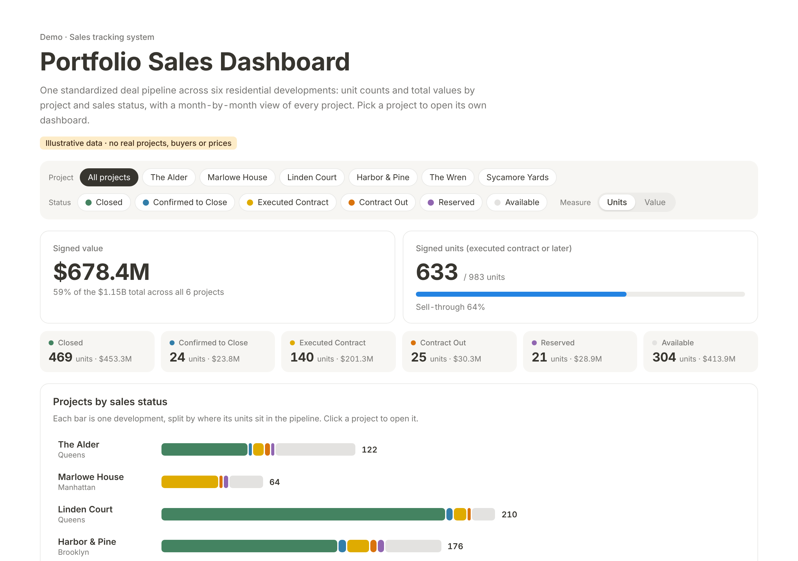
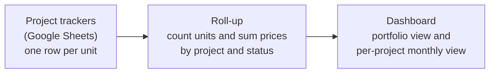
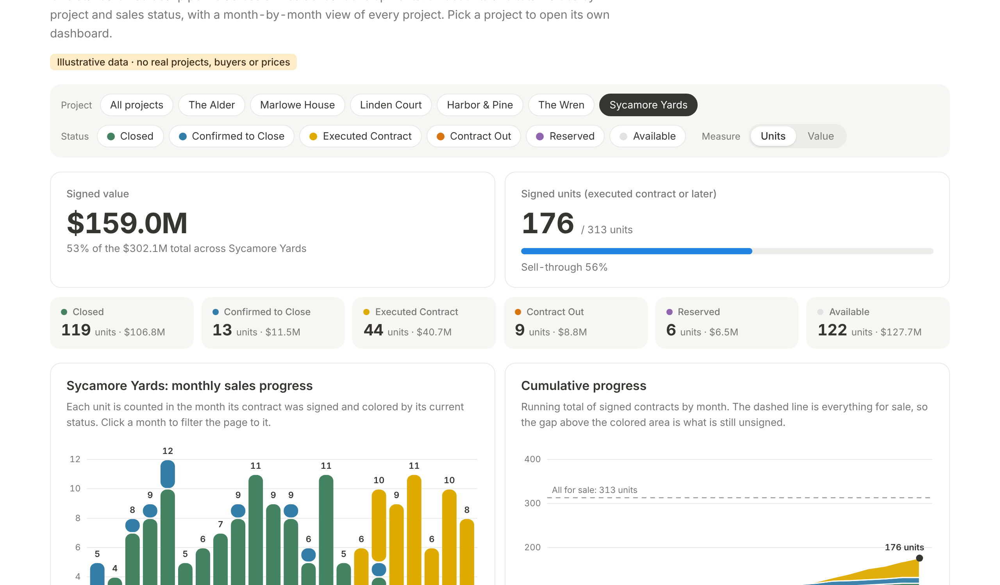

# Sales Tracking System: standardized trackers to a live dashboard

A sample recreation of a sales tracking system I rebuilt for a portfolio of New York residential developments: one standardized deal pipeline per project in Google Sheets, and a dashboard that rolls every project up by sales status.

**Everything in this repository is sample data.** The six projects, 983 units, prices and dates were generated for demonstration. No real project, buyer or price appears here.

## Try it

Open [`index.html`](index.html) in a browser. It is a single self-contained file: no build step, no server, no internet connection needed.

- Pick a project at the top to open its own dashboard.
- Filter by sales status, or switch between unit counts and dollar value.
- Click a month in a chart, or a cell in the month-by-month grid, to filter the page to it.

## The problem

Each project kept its own sales tracker, built at different times by different people. Statuses were spelled differently from file to file ("C/O" in one, "Contract Out" in another), columns sat in different places, and there was no single view across projects. Answering "how many units are under contract across the portfolio, and what are they worth?" meant opening every file and adding numbers up.

## What I built

1. **One schema for every project.** The same columns in the same order, and one status vocabulary enforced with a dropdown, so a unit can only be in one of six defined states.
2. **Dashboards that hold no typed numbers.** Unit counts and total values are formulas over the pipeline rows, so changing one unit's status or price updates every total.
3. **A portfolio view.** Because every tracker has the same shape, the same logic runs across all of them: units and value by project and status, and a month-by-month view of each project.

The real system covers six projects and nearly 1,000 units in Google Sheets. I used Claude and Gemini to standardize the deal pipelines and to build the dashboard layer.

## How it works

The tracker is the single source of truth. Sales updates are entered in one place, the Deal Pipeline tab, and nowhere else. The dashboard only reads.

There are two ways the roll-up runs:

| Where the dashboard lives | How it reads the trackers |
|---|---|
| A Dashboard tab inside each Google Sheet | `COUNTIF` and `SUMIFS` formulas over the Deal Pipeline tab. Recalculates as soon as a row changes. |
| A web dashboard | Reads each tracker's Deal Pipeline tab when the page is opened or refreshed, stacks the projects into one table, and computes every figure from those rows. |

The `index.html` in this repository is the web dashboard with the sample rows embedded in the page, so it runs anywhere. It computes its figures the same way the live version does, from the unit rows, in the browser.

## Data model

One row per unit, in the Deal Pipeline tab of each tracker.

| Column | Meaning |
|---|---|
| Unit | Unit number, for example `7C` or `PH-A` |
| Type | Studio, 1BR, 2BR, 3BR or PH |
| Floor, Line | Position in the building, used for the stacking plan |
| Status | One of the six values below |
| Sale price ($) | Contract price for signed units, list price otherwise |
| Contract signed | Date the contract was fully executed |
| Closing date | Actual closing date for closed units, target date for units under contract |

The status vocabulary, in pipeline order:

| Status | Meaning | Counts as signed |
|---|---|---|
| Available | Unsold and open for sale | No |
| Reserved | Held for a buyer, no contract yet | No |
| Contract Out | Contract sent to the buyer, not yet signed by both sides | No |
| Executed Contract | Contract signed by both sides | Yes |
| Confirmed to Close | Closing date confirmed with the buyer | Yes |
| Closed | Sale completed | Yes |

Sell-through is signed units divided by all units.

## Sample portfolio

| Project | Borough | Units | Signed | Sell-through | Signed value |
|---|---|---|---|---|---|
| The Alder | Queens | 122 | 65 | 53% | $62.6M |
| Marlowe House | Manhattan | 64 | 37 | 58% | $88.1M |
| Linden Court | Queens | 210 | 193 | 92% | $159.5M |
| Harbor & Pine | Brooklyn | 176 | 132 | 75% | $167.2M |
| The Wren | Brooklyn | 98 | 30 | 31% | $42.0M |
| Sycamore Yards | Queens | 313 | 176 | 56% | $159.0M |
| **All projects** | | **983** | **633** | **64%** | **$678.4M** |

These are generated figures. They are here so the dashboard has something realistic to show.

## What the dashboard shows

**Portfolio view**

- Signed value and signed units, with sell-through
- Units and value in each of the six statuses
- Every project as a bar split by status
- A grid of every project by month, for contracts signed or closings

**Project view**

- Monthly sales progress, stacked by current status
- Cumulative signed contracts against everything for sale
- A stacking plan: one cell per unit by floor and line
- Closings by month, completed and targeted
- The unit rows behind every number, sortable

## Repository contents

| Path | What it is |
|---|---|
| `index.html` | The dashboard. One self-contained file with the sample rows, fonts and charting library embedded. |
| `data/trackers/` | The six sample trackers as `.xlsx`. Each has a Deal Pipeline tab, a formula-driven Dashboard tab and a Status list tab. Upload one to Google Drive to open it as a Google Sheet. |
| `data/csv/` | The Deal Pipeline tab of each tracker as CSV. |
| `docs/project-brief.md` | A longer write-up of the project: context, decisions and definitions. |
| `docs/screenshots/` | Images used in this README. |

## Tools

Google Sheets (data validation, `COUNTIF`, `SUMIFS`), HTML, CSS and JavaScript, D3.js for the charts, and Claude and Gemini as working tools throughout.

## About

Built by Ying Jin. More of my work: [yingjin-0830.github.io](https://yingjin-0830.github.io)
